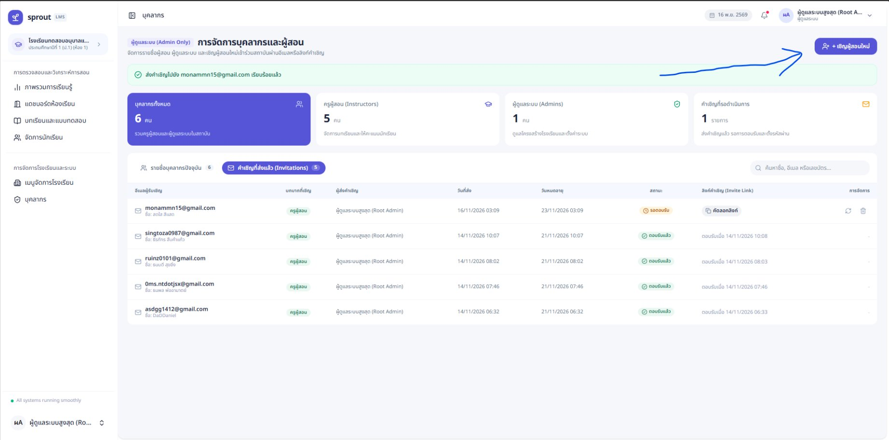

## ภาพรวมโครงสร้างสิทธิ์ผู้ใช้งาน (User Roles & Hierarchy)

ระบบ E-Learning ถูกออกแบบโครงสร้างการบริหารจัดการผู้ใช้งานแบบเป็นลำดับขั้น (Role-based Hierarchy) เพื่อความปลอดภัยและความสะดวกในการจัดการสิทธิ์ภายในโรงเรียน

:::note[สิทธิ์เริ่มต้นของระบบ (Default Admin)]
ระบบเริ่มต้นจะมี **ผู้ดูแลระบบ (Admin)** หลักให้ก่อนแล้ว 1 บัญชี ซึ่งมีสิทธิ์สูงสุดในการตั้งค่าระบบและสามารถบริหารจัดการเพิ่มสมาชิกได้ทุกส่วน
:::

- **โครงสร้างการมอบสิทธิ์และเพิ่มสมาชิก:**
  1. **ผู้ดูแลระบบ (Admin):** สามารถเชิญผู้ดูแลระบบร่วม (Admin) และเชิญคุณครูผู้สอน (Teacher) ได้
  2. **คุณครูผู้สอน (Teacher):** เมื่อตอบรับคำเชิญเข้าสู่ระบบแล้ว จะสามารถเพิ่มและจัดการข้อมูลนักเรียน (Student) ในระดับชั้น/ห้องเรียนได้
  3. **นักเรียน (Student):** ถูกเพิ่มเข้าสู่ระบบโดยครูผู้สอน เพื่อเข้าเรียน ดูสื่อวิดีโอ และทำแบบทดสอบวัดผล

```text
               +----------------------------------+
               |   ผู้ดูแลระบบเริ่มต้น (Admin)      |
               | (มีมาให้ 1 คนแรก จัดการได้ทุกอย่าง) |
               +-----------------+----------------+
                                 |
        +------------------------+------------------------+
        |                                                 |
        v                                                 v
[ เพิ่มผู้ดูแลระบบคนใหม่ ]                           [ เพิ่มคุณครูผู้สอน ]
(ส่งลิงก์คำเชิญทาง Email)                           (ส่งลิงก์คำเชิญทาง Email)
                                                          |
                                                          v
                                                 [ เพิ่มนักเรียนเข้าสู่ระบบ ]
                                                 (ผ่านเมนูจัดการนักเรียน)
```

---

## 1. การเชิญสมาชิกโดยผู้ดูแลระบบ (Admin Invitation)

ผู้ดูแลระบบสามารถส่งคำเชิญเพื่อเพิ่ม **ผู้ดูแลระบบคนใหม่** หรือ **คุณครูผู้สอน** เข้าสู่ระบบผ่านขั้นตอนเดียวกัน โดยมีรายละเอียดดังนี้:

### ขั้นตอนการทำงาน
1. เข้าสู่ระบบด้วยบัญชีผู้ดูแลระบบ
2. นำทางไปที่เมนู **"บุคลากร"** ในแถบเมนูด้านข้าง
3. คลิกปุ่ม **"+ เชิญผู้สอนใหม่"** ที่อยู่บริเวณมุมขวาบนของหน้าจอ

   

4. ระบบจะแสดงหน้าต่างแบบฟอร์มส่งคำเชิญ ให้กรอกข้อมูลดังต่อไปนี้:
   - **E-mail:** ระบุที่อยู่อีเมลของผู้ที่ต้องการเชิญเข้าใช้งาน (ต้องเป็นอีเมลที่สามารถเปิดรับข้อความได้จริง)
   - **ชื่อ-นามสกุล:** ระบุชื่อและนามสกุลจริงของผู้ที่ต้องการเชิญ
   - **เลือกบทบาท (Role):**
     - เลือก **"ผู้ดูแลระบบ" (Admin)** หากต้องการแต่งตั้งเป็นผู้ดูแลระบบ
     - เลือก **"ครูผู้สอน" (Teacher)** หากต้องการเพิ่มเป็นคุณครูประจำวิชา/ชั้นเรียน
5. ตรวจสอบความถูกต้อง แล้วคลิกปุ่ม **"ส่งคำเชิญ"**
6. **ผลลัพธ์:** ระบบจะสร้างลิงก์คำเชิญความปลอดภัยเฉพาะบุคคล (Unique Invitation Link) และส่งไปยังอีเมลของผู้รับโดยอัตโนมัติ พร้อมแสดงรายการในแท็บ **"คำเชิญที่ส่งแล้ว (Invitations)"**


:::tip[คำแนะนำในการส่งคำเชิญและติดตามสถานะ]
- เมื่อส่งคำเชิญสำเร็จ แถบสถานะด้านบนจะแสดงข้อความแจ้งเตือนสีเขียว เช่น *“ส่งคำเชิญไปยัง [email] เรียบร้อยแล้ว”*
- ผู้ดูแลระบบสามารถตรวจสอบสถานะคำเชิญได้จากแท็บ **"คำเชิญที่ส่งแล้ว (Invitations)"** ซึ่งจะระบุวันหมดอายุ (มีอายุ 7 วัน) และสถานะการตอบรับ
- หากผู้รับไม่ได้รับอีเมล ผู้ดูแลระบบสามารถกดปุ่ม **"คัดลอกลิงก์" (Copy Link)** ในตารางเพื่อส่งลิงก์คำเชิญให้ผู้สอนโดยตรงได้ทันที
:::

---

## 2. ขั้นตอนสำหรับผู้ได้รับลิงก์คำเชิญ (Accepting Invitation)

เมื่อผู้ได้รับการเชิญ (ไม่ว่าจะเป็นผู้ดูแลระบบหรือคุณครู) ได้รับอีเมลจากระบบ ให้ดำเนินการตอบรับคำเชิญเพื่อตั้งค่าบัญชีใช้งาน:

### ขั้นตอนการทำงาน
1. เปิดอีเมลที่ได้รับจากระบบ และคลิกที่ **ลิงก์คำเชิญ**
2. ระบบจะนำไปยังหน้าต่าง **"แบบฟอร์มตอบรับคำเชิญและตั้งค่าบัญชี"**
3. ให้กรอกข้อมูลส่วนตัวและความปลอดภัยให้ครบถ้วน:
   - **เลขบัตรประชาชน:** กรอกหมายเลขประจำตัวประชาชน 13 หลักเพื่อใช้ยืนยันตัวตน
   - **ตั้งรหัสผ่าน (Password):** กำหนดรหัสผ่านสำหรับการเข้าใช้งานระบบ
   - **ยืนยันรหัสผ่าน (Confirm Password):** พิมพ์รหัสผ่านซ้ำอีกครั้งให้ตรงกัน
4. คลิกปุ่ม **"ตอบรับคำเชิญ"**
5. **ผลลัพธ์:** เมื่อข้อมูลถูกต้องครบถ้วน ระบบจะเปิดใช้งานบัญชีทันที และนำทางผู้ใช้งานเข้าสู่หน้า **Dashboard** ตามบทบาทที่ได้รับการแต่งตั้งโดยอัตโนมัติ:
   - กรณีเป็นผู้ดูแลระบบ $\rightarrow$ นำทางเข้าสู่หน้า **Admin Dashboard**
   - กรณีเป็นครูผู้สอน $\rightarrow$ นำทางเข้าสู่หน้า **Teacher Dashboard**

```text
[ ผู้รับเปิด Email ] 
        |
        v
[ คลิกลิงก์คำเชิญ ] 
        |
        v
[ กรอกข้อมูล: เลขบัตรประชาชน + ตั้งรหัสผ่าน + ยืนยันรหัสผ่าน ]
        |
        v
[ กดปุ่ม "ตอบรับคำเชิญ" ]
        |
        +-----------------------------------+
        |                                   |
        v                                   v
[ เข้าสู่ Admin Dashboard ]     [ เข้าสู่ Teacher Dashboard ]
  (กรณีบทบาทผู้ดูแลระบบ)            (กรณีบทบาทคุณครูผู้สอน)
```

:::note[การเข้าใช้งานอัตโนมัติ]
เมื่อกดตอบรับคำเชิญสำเร็จ ระบบจะยืนยันตัวตนและนำทางเข้าสู่หน้า Dashboard ตามตำแหน่งทันที ไม่จำเป็นต้องกรอกรหัสผ่านเพื่อเข้าสู่ระบบซ้ำอีกรอบ
:::

---

## 3. การเพิ่มนักเรียนเข้าสู่ระบบโดยคุณครู (Student Registration)

คุณครูผู้สอนสามารถนำเข้านักเรียนในความดูแลเข้าสู่ระบบ เพื่อให้นักเรียนสามารถเริ่มเข้าเรียนและทำแบบทดสอบได้

### ขั้นตอนการทำงาน
1. เข้าสู่ระบบด้วยบัญชีคุณครูผู้สอน
2. นำทางไปที่เมนู **"จัดการนักเรียน"**
3. คลิกปุ่ม **"เพิ่มนักเรียน"** ที่อยู่บริเวณมุมขวาบนของหน้าจอ
4. กรอกข้อมูลของนักเรียนในแบบฟอร์ม:
   - **ชื่อ-นามสกุล:** ระบุชื่อและนามสกุลจริงของนักเรียน
   - **เลขบัตรประชาชน:** หมายเลขประจำตัวประชาชนของนักเรียน (ใช้เป็นข้อมูลหลักในการระบุตัวตนและเข้าใช้งาน)
   - **ระดับชั้น/ห้องเรียน:** เช่น ประถมศึกษาปีที่ 2/1 (ป.2/1)
5. คลิกปุ่ม **"บันทึก"**
6. **ผลลัพธ์:** ข้อมูลนักเรียนจะถูกบันทึกเข้าสู่ฐานข้อมูลระบบทันที นักเรียนจะมีชื่อปรากฏในรายชื่อห้องเรียน และพร้อมสำหรับการเข้าสู่ระบบเพื่อเรียนบทเรียน

:::caution[ข้อควรระวังในการบันทึกข้อมูลนักเรียน]
โปรดตรวจสอบเลขบัตรประจำตัวประชาชนของนักเรียนให้ถูกต้องครบ 13 หลัก เนื่องจากเป็นข้อมูลสำคัญที่ใช้ยืนยันตัวตนในการประเมินผลการเรียน
:::

---

## 4. ตารางเปรียบเทียบสิทธิ์และหน้าที่ในการจัดการสมาชิก

| บทบาท (Role) | เมนูที่ใช้งาน | สิทธิ์การเพิ่มสมาชิก | ข้อมูลที่ใช้ในระบบ |
| :--- | :--- | :--- | :--- |
| **ผู้ดูแลระบบ (Admin)** | เมนู **บุคลากร** $\rightarrow$ ปุ่ม *+ เชิญผู้สอนใหม่* | • เพิ่มผู้ดูแลระบบใหม่<br/>• เพิ่มคุณครูผู้สอน | อีเมล, ชื่อ-นามสกุล, เลือกบทบาท (ผู้ดูแลระบบ / ครูผู้สอน) ระบบส่งลิงก์ไปทาง Email |
| **ผู้รับคำเชิญ (Admin / Teacher)** | ลิงก์ที่ได้รับจาก **Email** คำเชิญ | • ตอบรับและเปิดใช้งานบัญชีตนเอง | เลขบัตรประชาชน, ตั้งรหัสผ่าน, ยืนยันรหัสผ่าน |
| **คุณครูผู้สอน (Teacher)** | เมนู **จัดการนักเรียน** $\rightarrow$ ปุ่ม *เพิ่มนักเรียน* | • เพิ่มนักเรียนเข้าสู่ระบบ | ชื่อ-นามสกุล, เลขบัตรประชาชน, ระดับชั้น/ห้องเรียน |

---

## 5. ข้อแนะนำและความปลอดภัย

1. **การตรวจสอบอีเมลคำเชิญ:** ผู้ที่ได้รับคำเชิญควรตรวจสอบในโฟลเดอร์กล่องจดหมายหลัก หรือโฟลเดอร์ Junk/Spam หากไม่พบอีเมลภายในไม่กี่นาที
2. **ความปลอดภัยของรหัสผ่าน:** การตั้งรหัสผ่านสำหรับบุคลากรควรมีความยาวและมาตรฐานความปลอดภัยที่เหมาะสม
3. **ความถูกต้องของเลขบัตรประชาชน:** เลขบัตรประชาชนของทั้งบุคลากรและนักเรียนจะต้องไม่ซ้ำซ้อนกับผู้ใช้งานอื่นที่มีอยู่ในระบบ
