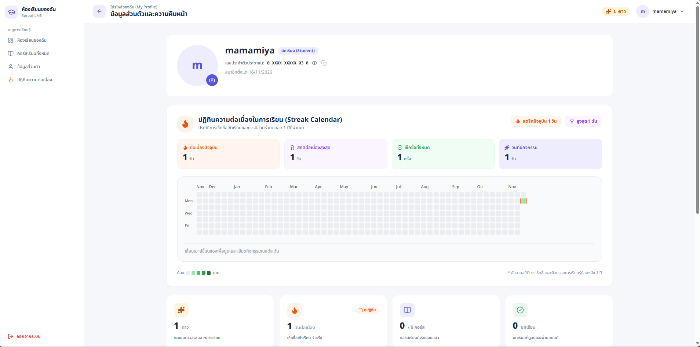
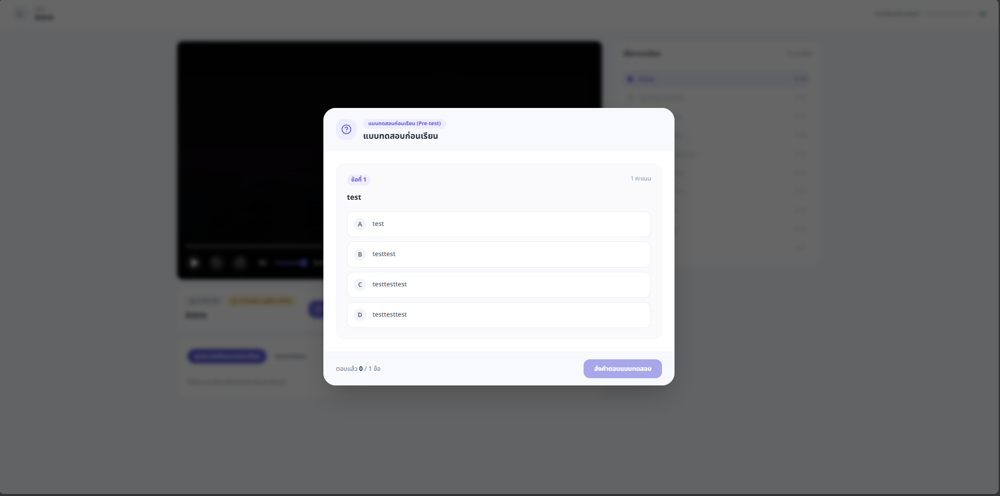
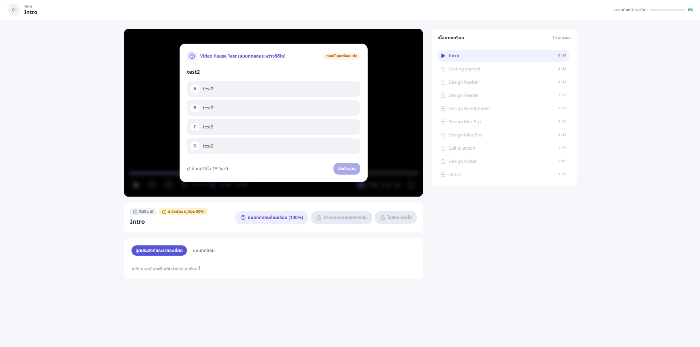
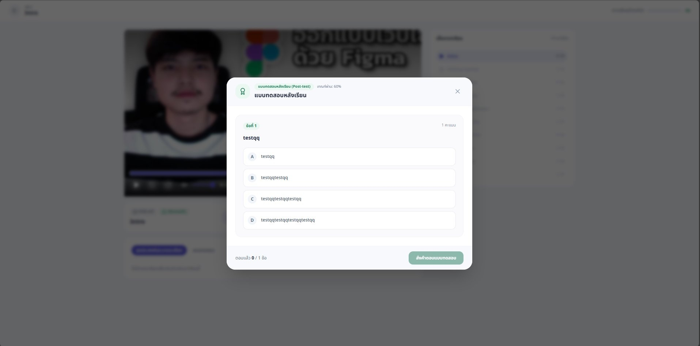

## แนวคิดหลัก

ระบบ **Web E-Learning ฝั่งนักเรียน (Student)** สำหรับนักเรียนชั้นประถมศึกษาปีที่ 2 (ป.2) ออกแบบโดยใช้แนวคิดการเรียนรู้ตามลำดับขั้น (Sequential Learning) ที่มีขั้นตอนชัดเจนและเข้าใจง่าย เหมาะสมกับผู้เรียนวัยประถมศึกษาตอนต้น

:::note[แนวคิดการเรียนรู้]
นักเรียนจะได้เรียนรู้ผ่านการวัดความรู้พื้นฐานก่อนเรียน การรับชมวิดีโอบทเรียนที่สามารถทบทวนซ้ำได้ การตอบคำถามระหว่างดูวิดีโอ และการทำแบบทดสอบหลังเรียนเพื่อปลดล็อกเข้าสู่บทเรียนถัดไป
:::

---

## 1. หน้า Dashboard ของนักเรียน (Student Dashboard)

- นักเรียนสามารถเข้าดู **หน้า Dashboard และข้อมูลโปรไฟล์ส่วนตัว** ได้ทันทีเมื่อเข้าสู่ระบบ
- แสดงภาพรวมข้อมูลการเรียนของตนเอง เช่น รหัสนักเรียน, คะแนนดาวสะสมจากการเรียน, จำนวนคอร์สที่เรียนจบ, และบทเรียนที่ผ่านเกณฑ์
- **ปฏิทินความต่อเนื่องในการเรียน (Streak Calendar):** แสดงสถิติการเข้าเรียนต่อเนื่อง (Current Streak), สถิติต่อเนื่องสูงสุด, ประวัติการเช็คชื่อเข้าเรียน และตาราง Heatmap กิจกรรมการเรียนตลอด 1 ปี
- ช่วยให้นักเรียนทราบความคืบหน้าของตนเอง มีแรงจูงใจในการเข้าเรียนอย่างสม่ำเสมอ และเข้าถึงบทเรียนที่ต้องเรียนต่อได้ง่าย



---

## 2. การทำข้อสอบก่อนเรียน (Pre-test)

- เมื่อเลือกบทเรียนแล้ว นักเรียนจะต้อง **ทำข้อสอบ Pre-test ก่อน** จึงจะสามารถเข้าไปดูวิดีโอบทเรียนได้
- แบบทดสอบ Pre-test ทำหน้าที่วัดความรู้พื้นฐานของนักเรียนก่อนเริ่มเรียนเนื้อหาใหม่
- แสดงหน้าต่างแบบทดสอบขึ้นมาทับหน้าวิดีโอ ให้นักเรียนเลือกคำตอบ A, B, C หรือ D ในแต่ละข้อ และคลิกปุ่ม **"ส่งคำตอบแบบทดสอบ"**
- เมื่อนักเรียนทำข้อสอบ Pre-test เสร็จเรียบร้อย ระบบจะบันทึกคะแนนและปลดล็อกให้เข้าสู่หน้าวิดีโอการสอนของบทเรียนนั้นทันที



:::tip[ทำก่อนเข้าบทเรียนเสมอ]
ระบบจะไม่อนุญาตให้นักเรียนข้ามไปดูวิดีโอโดยตรง เพื่อให้ได้ข้อมูลวัดผลสัมฤทธิ์ที่แท้จริงก่อนเรียน
:::

---

## 3. การดูวิดีโอบทเรียนและการทำคำถามในวิดีโอ

- **การรับชมวิดีโอบทเรียน:** นักเรียนเข้าดูวิดีโอการสอนประจำบทเรียนหลังจากทำ Pre-test เสร็จสิ้น โดยมีแถบแสดงเนื้อหาบทเรียนย่อยทั้งหมด (Curriculum) อยู่ทางด้านขวา
- **คำถามแทรกในวิดีโอ (Video Pause Test):** ในระหว่างที่กำลังดูวิดีโอ เมื่อถึงช่วงเวลาที่คุณครูกำหนดไว้ วิดีโอจะหยุดเล่นอัตโนมัติและแสดงหน้าต่างคำถามขึ้นมาโดยระบุ *"ตอบให้ถูกเพื่อเล่นต่อ"*
- **การกดย้อนดูเนื้อหา (Replay Video):** หากนักเรียนยังไม่แน่ใจคำตอบ สามารถกดปุ่ม **"ย้อนดูวิดีโอ 15 วินาที"** เพื่อทบทวนเนื้อหาก่อนตอบคำถามได้
- เมื่อเลือกคำตอบที่ถูกต้องแล้ว ให้คลิกปุ่ม **"ส่งคำตอบ"** เพื่อให้วิดีโอเล่นต่อไปจนจบ



---

## 4. การทำข้อสอบหลังเรียน (Post-test) และการเรียนบทถัดไป

- **การทำข้อสอบ Post-test:** เมื่อนักเรียนดูวิดีโอบทเรียนจนจบตามเกณฑ์ที่กำหนด ระบบจะแสดงหน้าต่างข้อสอบ **"แบบทดสอบหลังเรียน (Post-test)"** ขึ้นมาให้ทำทันที
- **เกณฑ์การผ่าน:** ในหน้าต่างแบบทดสอบจะระบุเกณฑ์คะแนนที่ต้องผ่าน (เช่น *เกณฑ์ผ่าน: 60%*)
- **การปลดล็อกบทเรียนถัดไป:** เมื่อนักเรียนทำข้อสอบ Post-test ส่งคำตอบและสอบผ่านตามเกณฑ์ ระบบจะทำการ **ปลดล็อกบทเรียนถัดไป** ในรายการเนื้อหาบทเรียนทันที เพื่อให้นักเรียนสามารถกดเข้าเรียนในหัวข้อถัดไปได้



---

## 5. การดูบัตรนักเรียนอิเล็กทรอนิกส์และการแก้ไขข้อมูลส่วนตัว (View Student E-Card & Edit Profile)

การสร้างและออกบัตรนักเรียนอิเล็กทรอนิกส์จะได้รับการบริหารจัดการโดยคุณครูผู้สอน สำหรับฝั่งนักเรียนจะเน้นไปที่ **การดูข้อมูลบัตรประจำตัว** และ **การแก้ไขข้อมูลส่วนตัวเบื้องต้น** ด้วยตนเอง:

- **การดูบัตรนักเรียนอิเล็กทรอนิกส์ (View E-Card):**
  - นักเรียนสามารถเข้าไปที่เมนู **"ข้อมูลส่วนตัว"** หรือหน้า Dashboard ของตนเอง เพื่อตรวจสอบข้อมูลบัตรนักเรียน
  - แสดงข้อมูลชื่อ-นามสกุล, รหัสนักเรียน, เลขประจำตัวประชาชน (สามารถคลิกไอคอนรูปดวงตาเพื่อดูหรือซ่อนตัวเลขได้) และวันที่เริ่มเข้าใช้งานระบบ
  - ตรวจสอบรหัสประจำตัวและ Login PIN 4 หลักที่ได้รับจากคุณครูสำหรับใช้เข้าสู่ระบบ
- **การแก้ไขข้อมูลส่วนตัว (Edit Profile):**
  - **เปลี่ยนรูปภาพโปรไฟล์:** นักเรียนสามารถคลิกที่ไอคอนกล้อง (📷) บริเวณรูปประจำตัว เพื่อเลือกอัปโหลดรูปภาพใหม่ของตนเองได้ตามต้องการ
  - **ติดตามสถิติการเรียนรู้:** ตรวจสอบความถูกต้องของระดับชั้น คะแนนดาวสะสม และสถิติปฏิทินความต่อเนื่องในการเรียน (Streak)
  - :::note[การจัดการข้อมูลหลักของบัตร]
    การแก้ไขข้อมูลสำคัญในบัตรนักเรียน (เช่น ชื่อ-นามสกุล, เลขประจำตัวประชาชน, หรือการออกบัตรใหม่) จะดำเนินการโดยคุณครูผู้สอนผ่านระบบจัดการนักเรียน เพื่อรักษาความถูกต้องและความปลอดภัยของข้อมูลโรงเรียน
    :::

---

## แผนผังขั้นตอนการเรียนของนักเรียน (Student Learning Flow)

```text
               [ เข้าสู่ระบบด้วยบัตรนักเรียน E-Card (PIN 4 หลัก / QR Code) ]
                                |
                                v
               [ นักเรียนดูหน้า Dashboard ของตัวเอง ]
                                |
                                v
                      [ เลือกบทเรียนที่ต้องการเรียน ]
                                |
                                v
               [ 1. ทำข้อสอบก่อนเรียน (Pre-test) ]
                    (ต้องทำก่อนจึงจะเข้าดูวิดีโอได้)
                                |
                                v
               [ 2. เข้าดูวิดีโอบทเรียน ] <------------------+
                                |                         |
                                v                         | (ถ้าไม่เข้าใจ:
               [ 3. ทำคำถามระหว่างดูวิดีโอ ]              |  กดดูวิดีโออีกรอบได้)
                  (คำถามที่คุณครูเพิ่มไว้ในวิดีโอ)             |
                                |                         |
                                +-------------------------+
                                |
                         (เมื่อดูวิดีโอจบ)
                                |
                                v
               [ 4. ทำข้อสอบหลังเรียน (Post-test) ]
                                |
                       (เมื่อทำข้อสอบเสร็จ)
                                |
                                v
                 [ 5. สามารถเรียนบทเรียนถัดไปได้ ]
```

### สรุปลำดับเงื่อนไขการเรียนของนักเรียน

- **ขั้นที่ 1 (Pre-test):** ต้องทำข้อสอบ Pre-test ให้เสร็จก่อน จึงจะเข้าดูวิดีโอบทเรียนได้
- **ขั้นที่ 2 (Video & In-Video Quiz):** ดูวิดีโอบทเรียนพร้อมตอบคำถามที่คุณครูแทรกไว้ในวิดีโอ และกดดูซ้ำอีกรอบได้หากยังไม่เข้าใจ
- **ขั้นที่ 3 (Post-test):** เมื่อดูวิดีโอจบ จะมีข้อสอบ Post-test ขึ้นมาให้ทำทันที
- **ขั้นที่ 4 (Next Lesson):** เมื่อทำข้อสอบ Post-test เสร็จ จึงจะสามารถเข้าเรียนบทเรียนถัดไปได้

---

## สรุปสำหรับการนำเสนออาจารย์

ระบบฝั่งนักเรียนชั้น ป.2 ออกแบบให้มีลำดับการเรียนรู้ที่เป็นขั้นตอนชัดเจน เริ่มจากการดูความคืบหน้าของตนเองบนหน้า Dashboard จากนั้นเข้าสู่บทเรียนด้วยการทำ Pre-test ก่อนเพื่อวัดพื้นฐาน แล้วจึงเข้าชมวิดีโอการสอนที่มีคำถามแทรกอยู่ระหว่างเรียนเพื่อกระตุ้นความสนใจ โดยหากนักเรียนยังไม่เข้าใจก็สามารถกดดูวิดีโอซ้ำอีกรอบได้

เมื่อรับชมวิดีโอจบ ระบบจะแสดงข้อสอบ Post-test ให้ทำเพื่อวัดผลสัมฤทธิ์หลังเรียน และเมื่อทำข้อสอบเสร็จสมบูรณ์ ระบบจึงจะเปิดให้เรียนบทถัดไป แนวทางนี้ช่วยให้นักเรียนชั้น ป.2 เรียนรู้เนื้อหาอย่างเป็นลำดับและเข้าใจบทเรียนอย่างครบถ้วน

---

## ประเด็นสำคัญ

:::tip[สรุปภาพรวมสำคัญ]
**นักเรียนเรียนรู้ตามลำดับขั้น: ดู Dashboard ตัวเอง $\rightarrow$ ทำ Pre-test $\rightarrow$ ดูวิดีโอบทเรียน (ดูซ้ำได้) และทำคำถามในวิดีโอ $\rightarrow$ ทำ Post-test เมื่อดูจบ $\rightarrow$ เรียนบทถัดไป**
:::
