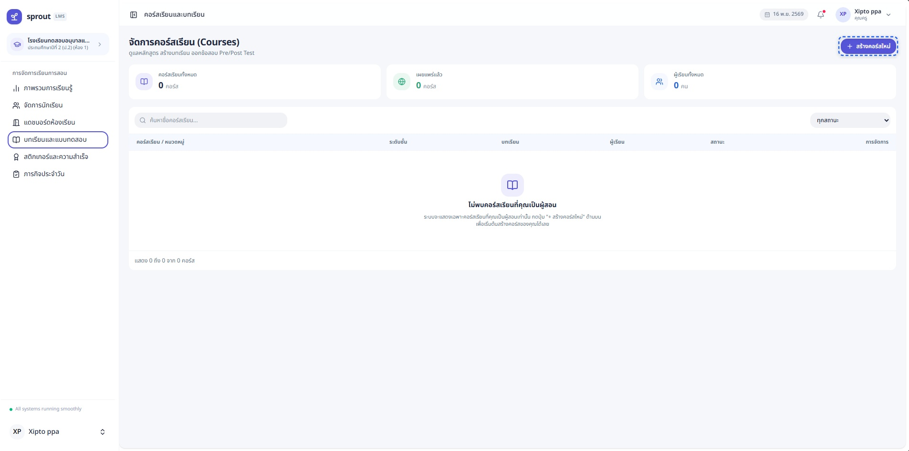
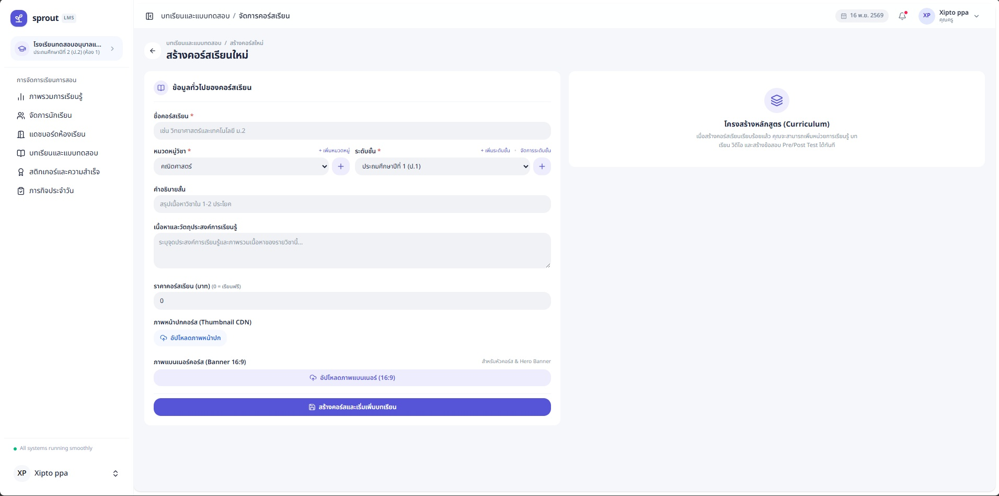
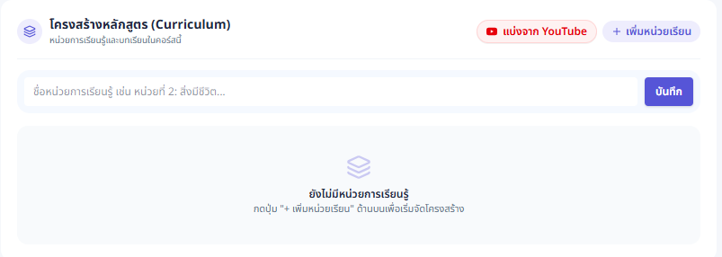
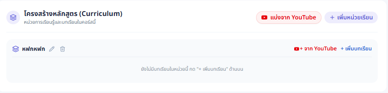
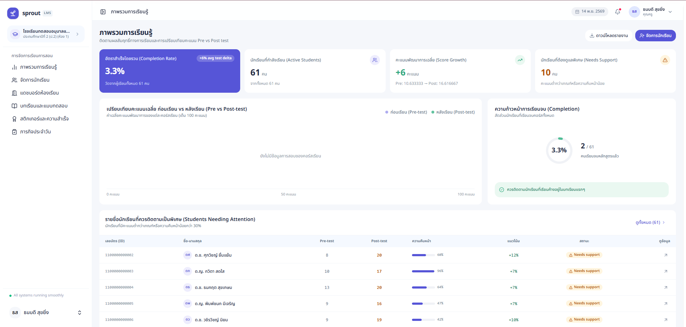

## แนวคิดหลัก

ระบบ **Web E-Learning ฝั่งคุณครู (Teacher)** สำหรับนักเรียนชั้นประถมศึกษาปีที่ 2 (ป.2) ทำหน้าที่เป็นศูนย์กลางในการบริหารจัดการสื่อการสอน บทเรียน และแบบวัดผล รวมถึงเป็นเครื่องมือสำหรับติดตามพัฒนาการเรียนรู้ของนักเรียนทั้งในระดับรายบุคคลและภาพรวมของทั้งชั้นเรียน

:::note[หัวใจหลักในการออกแบบ]
การออกแบบระบบฝั่งคุณครูเน้นความสะดวกในการนำเข้าสื่อวิดีโอ ความยืดหยุ่นในการสร้างข้อสอบทุกช่วงการเรียนรู้ และการแสดงผลข้อมูลผลการเรียนที่เข้าใจง่ายและนำไปใช้พัฒนาผู้เรียนได้ทันที
:::

---

## 1. การกดปุ่มสร้างคอร์สเรียนใหม่ (Create Course)

คุณครูสามารถเริ่มต้นสร้างหลักสูตรหรือวิชาเรียนใหม่ได้จากเมนูจัดการคอร์สเรียน โดยมีขั้นตอนดังนี้:

### ขั้นตอนการทำงาน
1. เข้าสู่ระบบด้วยบัญชีคุณครูผู้สอน
2. ในแถบเมนูด้านซ้าย นำทางไปที่เมนู **"บทเรียนและแบบทดสอบ"**
3. ระบบจะแสดงหน้ารายการจัดการคอร์สเรียน ให้คลิกปุ่ม **"+ สร้างคอร์สใหม่"** (ปุ่มสีม่วงที่มุมขวาบนตามที่ลูกศรชี้)



---

## 2. กรอกข้อมูลบทเรียนและคอร์สเรียน (Course Information)

หลังจากกดปุ่มสร้างคอร์สใหม่ ระบบจะนำเข้าสู่หน้าต่างสำหรับระบุรายละเอียดของคอร์สเรียน

### ขั้นตอนการทำงาน
1. ในหน้า **"สร้างคอร์สเรียนใหม่"** ให้กรอกข้อมูลทั่วไปของคอร์สเรียนให้ครบถ้วน:
   - **ชื่อคอร์สเรียน:** กำหนดชื่อวิชาหรือชื่อหลักสูตร (เช่น *วิทยาศาสตร์และเทคโนโลยี ม.2*)
   - **หมวดหมู่วิชา:** เลือกหมวดหมู่วิชาหลัก (เช่น *คณิตศาสตร์*, *วิทยาศาสตร์*) หรือกด `+ เพิ่มหมวดหมู่`
   - **ระดับชั้น:** เลือกระดับชั้นเรียนที่เปิดสอน (เช่น *ประถมศึกษาปีที่ 1 (ป.1)* หรือ *ประถมศึกษาปีที่ 2 (ป.2)*)
   - **คำอธิบายสั้น:** สรุปเนื้อหาสำคัญของรายวิชาสั้นๆ ใน 1-2 ประโยค
   - **เนื้อหาและวัตถุประสงค์การเรียนรู้:** ระบุเป้าหมายการเรียนรู้และขอบเขตเนื้อหาของวิชา
   - **ราคาคอร์สเรียน (บาท):** ระบุราคาค่าเรียน (หากเป็นการเรียนการสอนฟรีในโรงเรียน ให้กรอกเป็น `0`)
   - **ภาพหน้าปกคอร์ส (Thumbnail CDN):** อัปโหลดรูปภาพหน้าปกสำหรับแสดงในหน้ารายการคอร์ส
   - **ภาพแบนเนอร์คอร์ส (Banner 16:9):** อัปโหลดภาพแบนเนอร์สำหรับแสดงที่หัวข้อคอร์ส
2. ตรวจสอบข้อมูลทั้งหมด แล้วคลิกปุ่ม **"สร้างคอร์สและเริ่มเพิ่มบทเรียน"** ด้านล่าง



---

## 3. กดปุ่มเพิ่มหน่วยเรียน (Add Unit / Curriculum)

เมื่อสร้างข้อมูลทั่วไปของคอร์สเสร็จสิ้น ระบบจะพาเข้าสู่ส่วน **"โครงสร้างหลักสูตร (Curriculum)"** เพื่อจัดระเบียบเนื้อหาออกเป็นหน่วยการเรียนรู้

### ขั้นตอนการทำงาน
1. ในกล่องโครงสร้างหลักสูตร ให้คลิกปุ่ม **"+ เพิ่มหน่วยเรียน"** (ปุ่มสีม่วงอ่อนที่มุมขวาบน)
2. ระบบจะแสดงช่องพิมพ์สำหรับกรอกชื่อหน่วยเรียน ให้ระบุ **ชื่อหน่วยการเรียนรู้** (เช่น *หน่วยที่ 1: สิ่งมีชีวิตรอบตัว*, *หน่วยที่ 2: แรงและการเคลื่อนที่*)
3. คลิกปุ่ม **"บันทึก"** เพื่อสร้างหน่วยการเรียนรู้เข้าสู่คอร์ส



---

## 4. เพิ่มลิงก์ YouTube (Add YouTube Video Link)

หลังจากสร้างหน่วยการเรียนรู้เรียบร้อยแล้ว คุณครูสามารถนำวิดีโอการสอนจาก YouTube เข้ามาผูกเข้ากับหน่วยเรียนได้อย่างสะดวกรวดเร็ว

### ขั้นตอนการทำงาน
1. ภายในแถบหน่วยการเรียนรู้ที่สร้างไว้ ให้คลิกปุ่ม **"+ จาก YouTube"** (ปุ่มสีแดงที่มีไอคอน YouTube) หรือปุ่ม **"แบ่งจาก YouTube"**
2. นำลิงก์วิดีโอ (YouTube URL) ของบทเรียนการสอนมาวางเชื่อมต่อเข้ากับระบบ
3. วิดีโอจะถูกผูกเข้ากับหน่วยการเรียนรู้ทันที พร้อมสำหรับการจัดเรียงลำดับบทเรียนและการตั้งค่าคำถามวัดผล



:::tip[ข้อดีของการเชื่อมต่อด้วย YouTube URL]
ช่วยประหยัดพื้นที่จัดเก็บและ Bandwidth ของเซิร์ฟเวอร์โรงเรียน อีกทั้งรองรับการเล่นวิดีโอแบบ Adaptive Bitrate Streaming ทำให้นักเรียนสามารถรับชมบทเรียนได้อย่างลื่นไหลทุกระดับความเร็วเน็ต
:::

---

## 5. การเพิ่มข้อสอบแทรกในวิดีโอ (In-Video Quiz)

- คุณครูสามารถ **เพิ่มข้อสอบหรือคำถามแทรกเข้าไปในวิดีโอการสอน** ได้ตามช่วงเวลาที่ต้องการ
- เมื่อนักเรียนรับชมวิดีโอถึงช่วงเวลาที่กำหนด ระบบจะหยุดเล่นชั่วคราวและแสดงคำถามขึ้นมาให้นักเรียนตอบก่อนรับชมเนื้อหาส่วนต่อไป
- คุณครูสามารถกำหนดจำนวนข้อคำถามแทรกในวิดีโอได้อย่างอิสระ เพื่อกระตุ้นความสนใจและตรวจสอบความเข้าใจของนักเรียนระหว่างเรียน

---

## 6. การเพิ่มข้อสอบ Pre-test และ Post-test

- **การเพิ่มข้อสอบ Pre-test (ก่อนเรียน):** สร้างแบบทดสอบก่อนเรียนเพื่อประเมินความรู้พื้นฐานของนักเรียนก่อนเริ่มเข้าดูวิดีโอบทเรียน
- **การเพิ่มข้อสอบ Post-test (หลังเรียน):** สร้างแบบทดสอบหลังเรียนเพื่อวัดผลสัมฤทธิ์และความเข้าใจหลังจากนักเรียนดูวิดีโอจบ
- **ปรับเพิ่มจำนวนข้อสอบได้ตามต้องการ:** คุณครูสามารถสร้างและเพิ่มจำนวนข้อสอบในแต่ละชุด (ทั้ง Pre-test, ข้อสอบในวิดีโอ และ Post-test) ได้อย่างอิสระตามความเหมาะสมของแต่ละวิชา

---

## 7. ระบบ Dashboard และสรุปผลการเรียนของนักเรียน

- **ดู Dashboard ของนักเรียนรายบุคคล:** คุณครูสามารถตรวจสอบข้อมูลการเรียนของนักเรียนแต่ละคนได้อย่างละเอียด เช่น บทเรียนที่กำลังเรียนอยู่ สถานะการผ่านบทเรียน และคะแนนสอบในแต่ละส่วน
- **ดูสรุปผลรวมของนักเรียนทั้งหมด:** ระบบแสดงภาพรวมผลการเรียนของนักเรียนทั้งชั้น ป.2 เช่น คะแนนเฉลี่ยจากการทำแบบทดสอบก่อนเรียน (Pre-test) คำถามระหว่างดูวิดีโอ และแบบทดสอบหลังเรียน (Post-test)
- ช่วยให้คุณครูสามารถเปรียบเทียบพัฒนาการของนักเรียนก่อนและหลังเรียน รวมถึงวิเคราะห์ได้ว่าเนื้อหาบทใดที่นักเรียนส่วนใหญ่เข้าใจดีหรือควรได้รับการทบทวนเพิ่มเติม



---

## แผนผังขั้นตอนการทำงานฝั่งคุณครู (Teacher Workflow)

```text
                        [ คุณครูเข้าสู่ระบบ ]
                                |
        +-----------------------+-----------------------+
        |                                               |
        v                                               v
[ 1. กดปุ่ม "+ สร้างคอร์สใหม่" ]                 [ ติดตามผลการเรียน ]
        |                                               |
        v                                               v
[ 2. กรอกข้อมูลบทเรียน/คอร์ส ]                   - ดู Dashboard ของนักเรียนรายคน
        |                                       - ดูสรุปผลรวมของนักเรียนทั้งหมด
        v
[ 3. กดปุ่มเพิ่มหน่วยเรียน ]
        |
        v
[ 4. เพิ่มลิงก์วิดีโอ YouTube ]
        |
        v
[ 5. เพิ่มข้อสอบแทรกในวิดีโอ (In-Video Quiz) ]
        |
        v
[ 6. เพิ่มข้อสอบ Pre-test และ Post-test ]
```

---

## สรุปสำหรับการนำเสนออาจารย์

ระบบฝั่งคุณครูถูกออกแบบให้ครอบคลุมกระบวนการจัดการเรียนการสอนออนไลน์สำหรับนักเรียนชั้น ป.2 อย่างครบวงจร ตั้งแต่การสร้างคอร์สเรียน การแบ่งหน่วยการเรียนรู้ การนำเข้าวิดีโอการสอนผ่านลิงก์ YouTube การแทรกข้อสอบเข้าไปในวิดีโอ ไปจนถึงการจัดทำแบบทดสอบ Pre-test และ Post-test ที่คุณครูสามารถปรับเพิ่มจำนวนข้อสอบได้อย่างยืดหยุ่น

นอกจากนี้ ระบบยังมีหน้า Dashboard ที่ช่วยให้คุณครูดูได้ทั้งข้อมูลของนักเรียนรายบุคคลและสรุปผลรวมของนักเรียนทั้งหมด ทำให้สามารถติดตามความก้าวหน้าและประเมินผลสัมฤทธิ์ทางการเรียนได้อย่างแม่นยำ

---

## ประเด็นสำคัญ

:::tip[สรุปภาพรวมสำคัญ]
**ระบบฝั่งคุณครูเน้นการสร้างคอร์สและจัดหน่วยการเรียนรู้ที่ใช้งานง่าย ควบคู่กับสื่อวิดีโอ YouTube และแบบทดสอบที่ยืดหยุ่น (Pre-test / In-Video Quiz / Post-test) พร้อมระบบติดตามผลการเรียนผ่าน Dashboard แบบเรียลไทม์**
:::
